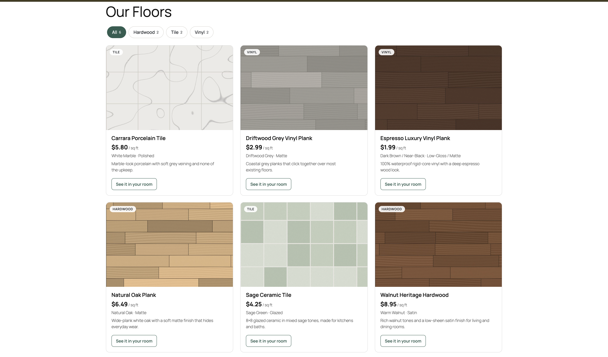
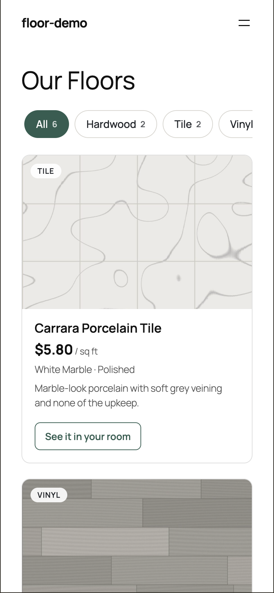
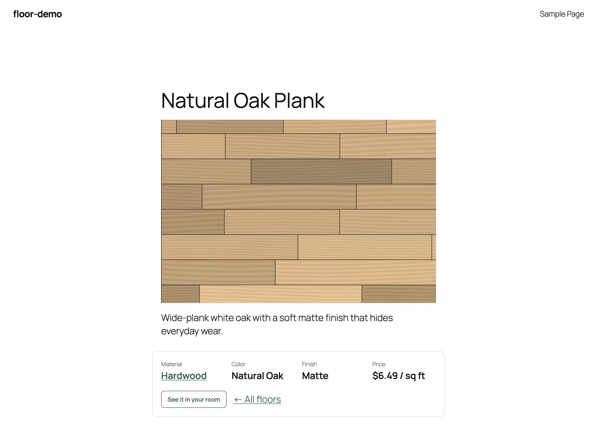
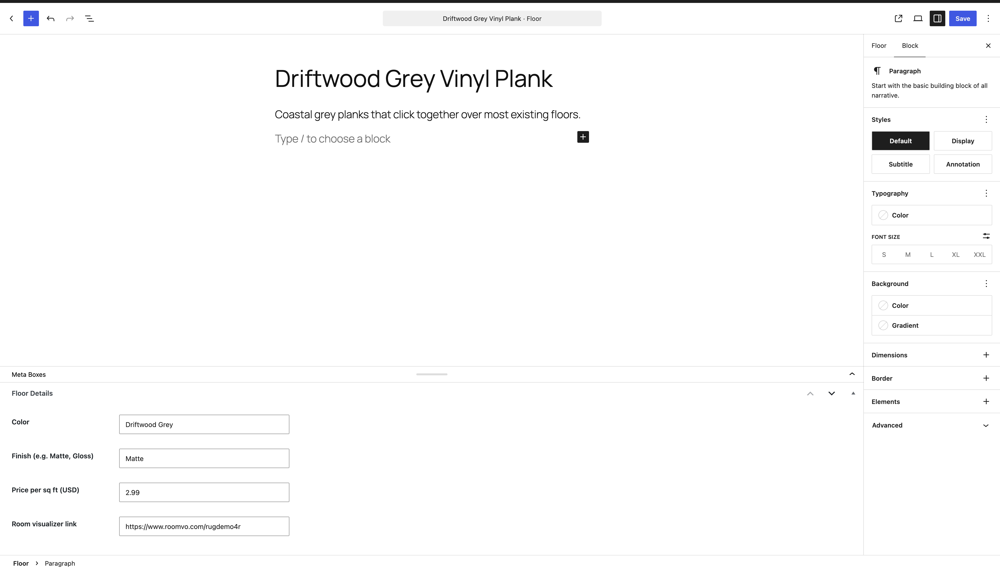
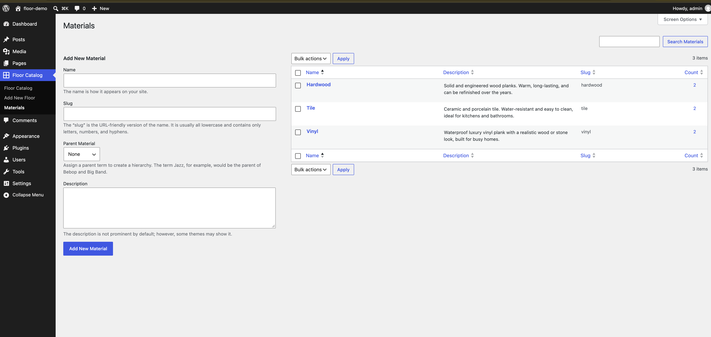

# Floor Catalog

A WordPress plugin for flooring retailers. Add your floors in WP Admin, then show them anywhere as a responsive, filterable product grid with one shortcode.

## Features

- **Floors** custom post type with its own admin menu, archive page (`/floors/`) and block-editor support
- **Material** taxonomy (Hardwood, Tile, Vinyl…) shown as a column in the admin list
- **Floor Details** fields: color, finish, price per sq ft, and a room-visualizer link
- **`[floor_catalog]` shortcode**: mobile-first card grid (1, 2 or 3 columns depending on the space available) with filter pills by material, each showing a count ("Tile 2")
- **Floor Catalog block**: the same grid as a dynamic block for the block editor and Site Editor, with a live preview. It reuses the shortcode's PHP, so the two always match
- **Polished product cards**: 3:2 image with a material badge, prominent price, a two-line excerpt, equal-height cards with an outline button pinned to the bottom, and a subtle hover lift and image zoom (turned off for `prefers-reduced-motion`)
- **Theme-proof styles**: buttons and links inside the catalog are reset, so a theme's padding, line-height and underlines don't leak in
- **Matches your theme**: inherits the theme's font and uses its `base` / `contrast` palette colors when available
- **Floors archive and single templates** (block themes, WordPress 6.7+): `/floors/` shows an "Our Floors" heading and the Floor Catalog block, and single floors drop the blog author/date line. A theme's own `archive-floor_product` / `single-floor_product` template, or one edited in the Site Editor, still takes priority
- **Friendly empty state** when no floors match, with an "Add a floor" shortcut for editors
- **Floor detail pages**: each floor's own page shows its material, color, finish, price and visualizer button
- Accessible: real buttons with `aria-pressed`, a live region announcing results, visible focus styles, 44px touch targets
- Fast: CSS and JS load only on pages that use the shortcode; no jQuery
- Secure: nonces, capability checks, sanitized input, escaped output

## Usage

```
[floor_catalog]                       all floors
[floor_catalog material="hardwood"]   one material (use its slug)
[floor_catalog limit="6"]             at most 6 floors
```

In the block editor, add the **Floor Catalog** block (search "floors"). It shows a live preview; settings in the sidebar are coming in a later version.

Each card shows the floor's excerpt. Set a short one under **Excerpt** in the floor's editor sidebar; if it's empty, the start of the description is used.

## Install

1. Copy the `floor-catalog` folder into `wp-content/plugins/`.
2. In WP Admin go to **Plugins** and activate **Floor Catalog**.
3. Add a few floors under **Floor Catalog → Add New Floor** (set a featured image, a material and the details).
4. Put `[floor_catalog]` on any page.

## File structure

```
floor-catalog/
├── floor-catalog.php        Plugin header, constants, activation hooks
├── includes/
│   ├── post-type.php        Floors post type + Material taxonomy
│   ├── meta-box.php         Floor Details fields (save + security checks)
│   ├── shortcode.php        [floor_catalog] grid, cards and empty state
│   ├── single.php           Details panel on each Floor's page
│   ├── templates.php        Block templates for /floors/ and single Floor pages
│   └── block.php            Registers the Floor Catalog block (renders via the shortcode)
├── blocks/
│   └── catalog/
│       ├── block.json       Block metadata (name, attributes, scripts)
│       ├── index.js         Editor script: plain JS, no build step
│       └── index.asset.php  Editor script dependencies (written by hand)
└── assets/
    ├── floor-catalog.css    Mobile-first grid, card and theme-color styles
    └── floor-catalog.js     Filter buttons
```

## Requirements

WordPress 6.0+ and PHP 7.4+. The archive and single Floor templates need WordPress 6.7+ and a block theme; older setups use the theme's templates.




| Mobile, filtered to Tile | Floor page |
| --- | --- |
|  |  |

### In WP Admin

| Editing a floor | Floor Catalog block |
| --- | --- |
|  |  |

## License

GPL-2.0-or-later
